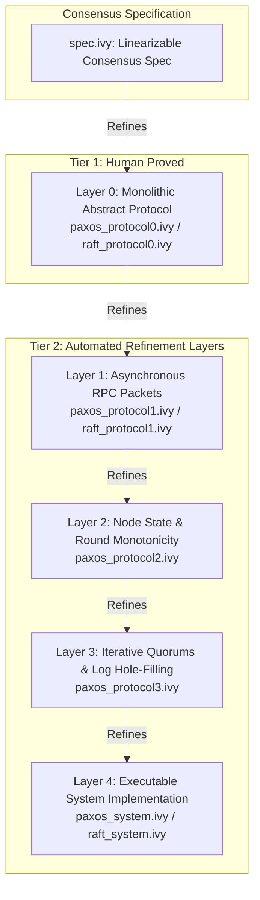
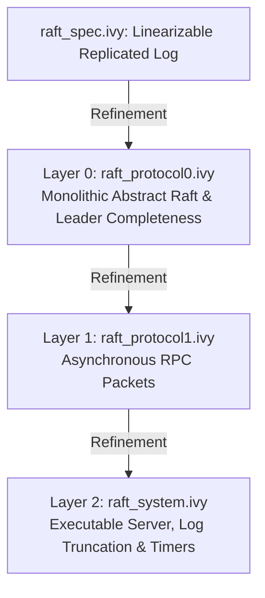

# Sift Architecture Specification: MultiPaxos & Raft Formal Verification

This document details the architectural design, layered refinement decomposition, and formal verification methodology of **Sift** ([Ma et al., USENIX ATC '22](file:///c:/Users/s-bas/Sift/Sift/sift_paper.pdf)) for both **MultiPaxos** and **Raft**.

---

## 1. Executive Summary & The Sift Methodology

### The Fundamental Verification Challenge
Proving that a distributed system implementation (like Raft or MultiPaxos) correctly implements consensus is notoriously difficult. Historically, verification required choosing between two painful extremes:
1. **Interactive Theorem Provers (IronFleet, Verdi, Lean, Coq):** Highly expressive, but require months of manual human effort writing thousands of lines of low-level proof tactics.
2. **Push-Button Model Checkers (I4, IC3PO, SWISS):** Automated, but cannot handle monolithic distributed implementations directly because quantifier alternations ($\forall \exists$ across quorums, rounds, and dynamic log slots) lead to undecidable first-order logic and solver timeouts.

### The Two-Tier Solution
Sift bridges this divide using a **Two-Tier Refinement-Guided Architecture**:
* **Tier 1 (Creative Human Modeling):** A human specifies the core consensus protocol at an abstract level (**Layer 0**) and establishes the primary inductive consensus invariant (e.g., Lamport's Safe Value Invariant in Paxos, or Leader Completeness in Raft).
* **Tier 2 (Automated Refinement Synthesis):** The system is decomposed into a series of intermediate refinement layers. Each layer introduces one concrete systems concern (e.g., message passing, iterative quorums, or concrete array memory). Because each refinement jump is local and compact, automated SMT solvers (**Z3**) and inductive synthesizers (**IC3PO**) can verify each step in seconds.



---

## 2. MultiPaxos Architecture (5-Layer Decomposition)

In Sift, MultiPaxos consensus over an unbounded sequence of log instances (`inst`) is factored into 5 distinct layers:

### Layer 0: Abstract Paxos ([`multipaxos/paxos_protocol0.ivy`](file:///c:/Users/s-bas/Sift/Sift/multipaxos/paxos_protocol0.ivy))
* **Responsibility:** Captures the core mathematical essence of Paxos without distributed message passing.
* **State Abstractions:**
  * `joined_round(N, R)`: Acceptor $N$ has joined round $R$.
  * `left_round(N, R)`: Acceptor $N$ has left round $R$ (promised a higher round).
  * `proposal(I, R, V)`: Value $V$ was proposed in slot $I$ during round $R$.
  * `vote(N, I, R, V)`: Acceptor $N$ voted for $(I, R, V)$.
  * `available(R, I)`: Slot $I$ is free for client proposals in round $R$.
* **Key Invariant (Lamport's Safe Value Theorem):**
  If round $R_2 > R_1$ proposes a differing value $V_2 \neq V_1$ in slot $I$ (or slot $I$ is available in $R_2$), every majority quorum $Q$ contains at least one node that left $R_1$ without voting for $(I, R_1, V_1)$:
  ```ivy
  invariant nset.majority(Q) & R1 < R2 & ((proposal(I, R2, V2) & V1 ~= V2) | available(R2, I)) -> (
      exists N:node. nset.member(N, Q) & left_round(N, R1) & ~vote(N, I, R1, V1)
  )
  ```

---

### Layer 1: Asynchronous RPC Messages ([`multipaxos/paxos_protocol1.ivy`](file:///c:/Users/s-bas/Sift/Sift/multipaxos/paxos_protocol1.ivy))
* **Responsibility:** Replaces atomic round joins with asynchronous in-flight network messages:
  * `one_a(R, I)`: Phase 1a Prepare RPC.
  * `one_b(N, R, V)`: Phase 1b Promise RPC carrying a `votemap_seg` of previous votes.
  * `two_a(I, R, V)`: Phase 2a Propose/Accept RPC.
  * `two_b(N, I, R, V)`: Phase 2b Accepted/Vote RPC.
* **Refinement Strategy:** Every action executes concrete packet transformations and invokes a **ghost action** in `protocol0`.
* **Simulation Theorem:**
  ```ivy
  invariant [safety] decision(I, V) -> protocol0.decision(I, V)
  ```

---

### Layer 2: Node-Centric Ballot Tracking ([`multipaxos/paxos_protocol2.ivy`](file:///c:/Users/s-bas/Sift/Sift/multipaxos/paxos_protocol2.ivy))
* **Responsibility:** Introduces node-local state variables for rounds and elections:
  * `current_round(N)`: Tracks the highest round observed by node $N$.
  * `round_active(N)`: Boolean flag indicating if node $N$ has established leadership.
  * `my_votes(N)`: Map from slot index $I$ to the highest ballot vote cast by node $N$.
* **Decoupling:** Decouples sending a 1b message from the leader's action of joining the round.

---

### Layer 3: Iterative Promise Accumulation ([`multipaxos/paxos_protocol3.ivy`](file:///c:/Users/s-bas/Sift/Sift/multipaxos/paxos_protocol3.ivy))
* **Responsibility:** In real networks, leaders do not atomically receive a full quorum of promises at once; they receive them one by one.
* **Key Mechanisms:**
  * `joined(N)`: Set of acceptors that have replied to Phase 1a so far.
  * `joined_votes(N)`: Running pointwise maximum of votes across all responding acceptors.
  * **Slot Hole Filling:** When `joined(N).majority` is reached, the leader scans all slots from `first` to `upper`. If a slot has votes, it adopts `maxv`; if empty (`maxr = 0`), it proposes `no_op` to ensure a contiguous log without holes.

---

### Layer 4: Executable System Implementation ([`multipaxos/paxos_system.ivy`](file:///c:/Users/s-bas/Sift/Sift/multipaxos/paxos_system.ivy))
* **Responsibility:** Matches the exact state variables of a real systems implementation (like UW CSE 452 / DSLabs `PaxosServer`):
  * `my_log`: Concrete decision log array (`slot -> decision`).
  * `first_undecided`: Next uncommitted log slot.
  * `inst_status`: Ballot status array tracking votes collected in the active round.
* **Network Shim & C++ Extraction:**
  * Uses [`paxos_trans.ivy`](file:///c:/Users/s-bas/Sift/Sift/multipaxos/paxos_trans.ivy) for socket serialization.
  * Compilable directly into native C++ code via `ivyc`.

---

## 3. Raft Architecture (3-Layer Decomposition)

Raft is a leader-driven replicated log protocol organized by terms (`term`) and log indices (`index`):



### Layer 0: Abstract Raft ([`raft/raft_protocol0.ivy`](file:///c:/Users/s-bas/Sift/Sift/raft/raft_protocol0.ivy))
* **Core Safety Theorems:**
  * **Leader Election Safety:** At most one leader can be elected per term.
  * **Log Matching Property:** If two logs contain an entry with the same index and term, they are identical up to that index:
    ```ivy
    invariant log_term(N, IX, T) & IX2 <= IX -> (log_val(N, IX2) = term_val(T, IX2))
    ```
  * **Leader Completeness (Core Invariant):** If an entry is committed by a majority quorum in term $T$, any leader in term $T_2 > T$ is guaranteed to contain that entry:
    ```ivy
    invariant term_logt(T, IX, T) & (exists Q. nset.majority(Q) & forall N. nset.member(N, Q) -> (append_reply(N, T, IX) | ~left_term(N, T))) & T2 > T & started(T2) -> term_logt(T2, IX, T)
    ```

---

### Layer 1: Asynchronous RPC Messages ([`raft/raft_protocol1.ivy`](file:///c:/Users/s-bas/Sift/Sift/raft/raft_protocol1.ivy))
* **Network Packets Modeled:**
  * `rqst_vote(S, T, IX, LOGT)`: RequestVote RPC broadcast by candidate $S$.
  * `vote_cand(S, T, D)`: RequestVote Response (grant vote / `votedFor`).
  * `append(T, IX, V, LOGT, PLOGT)`: AppendEntries RPC carrying command $V$ with previous entry log term `PLOGT` for consistency check.
  * `append_reply(S, T, IX)`: Follower ACK.
* **Log Up-To-Date Check:** Voter only grants vote if candidate's log is at least as up to date (`lastlogt < logt | (lastlogt = logt & lastix <= ix)`).

---

### Layer 2: Executable System Implementation ([`raft/raft_system.ivy`](file:///c:/Users/s-bas/Sift/Sift/raft/raft_system.ivy))
* **Concrete Server State:**
  * `mylogs: logs`: Dynamic vector of `log_entry` structs `(logv, logt)`.
  * `commit_ix`: State machine commit watermark.
  * `repliers: replierslog`: Vector of node sets tracking replication per index.
* **Conflict Resolution & Log Backtracking:**
  * Follower detects log conflicts, truncates conflicting tail, and appends valid entries.
  * On mismatch, follower sends NACK; leader decrements `nextIndex` via `handle_nack`.

---

## 4. Key Verification & Logic Constraints (EPR Fragment)

To make verification push-button with Z3, Sift maintains decidability within the **Effectively Propositional (EPR)** logic fragment:

1. **Segment Arithmetic vs Uninterpreted Functions:**
   * In [`votemap_segment.ivy`](file:///c:/Users/s-bas/Sift/Sift/multipaxos/votemap_segment.ivy), uninterpreted function `maxvote(M, I)` was replaced with inlined ternary conditionals `(M.value(I) if I < M.upper else not_a_vote)` to prevent Z3 E-matching quantifier loops.
2. **Decoupled Retransmissions:**
   * In [`paxos_system.ivy`](file:///c:/Users/s-bas/Sift/Sift/multipaxos/paxos_system.ivy), custom lossy packet retry loops (`ask_for_retransmission`) were commented out. In first-order logic, reasoning about packet loss timers introduces $\forall \exists$ alternations outside EPR. Sift verifies consensus over an abstract reliable transport shim.

---

## 5. Verification Commands

To check the inductive invariants across each isolate using Z3:

```powershell
# --- MultiPaxos Verification ---
cd c:\Users\s-bas\Sift\Sift\multipaxos
ivy_check isolate=protocol0 paxos_protocol0.ivy
ivy_check isolate=protocol1 paxos_protocol1.ivy
ivy_check isolate=protocol2 paxos_protocol2.ivy
ivy_check isolate=protocol3 paxos_protocol3.ivy

# --- Raft Verification ---
cd c:\Users\s-bas\Sift\Sift\raft
ivy_check isolate=protocol0 raft_protocol0.ivy
ivy_check isolate=protocol1 raft_protocol1.ivy
```
